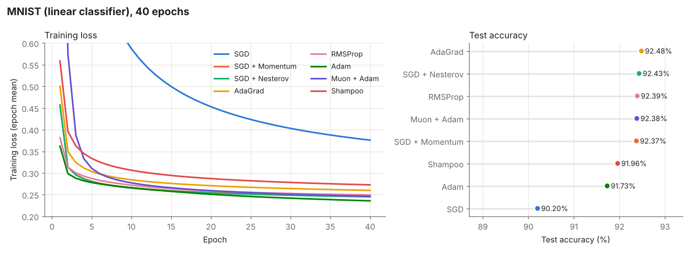
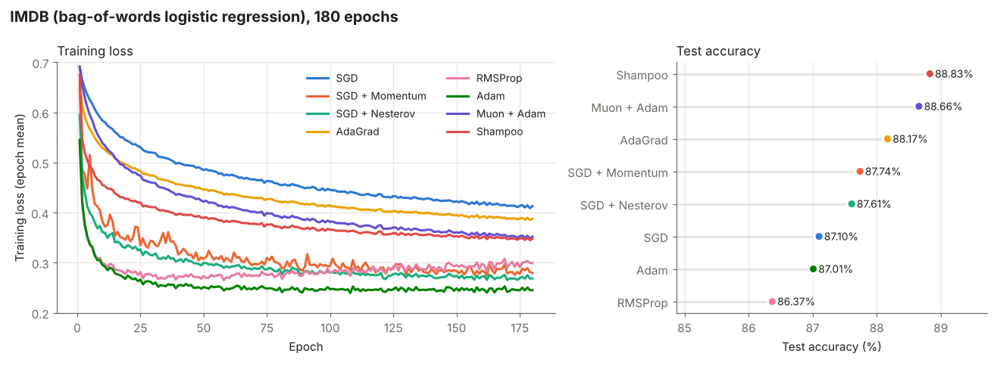

# Optimizer Benchmark Report

This report compares eight optimizers, all implemented from scratch in JAX, on three classic benchmarks from the Adam paper (Kingma & Ba, 2014). It covers what was run, what the results show, and the caveats to keep in mind before drawing conclusions.

The derivations behind each optimizer are in [`optim/optimizers/README.md`](optim/optimizers/README.md). This document is about how the optimizers behaved.

**Data status.** MNIST and IMDB were re-run in October 2026 for all eight optimizers. That run includes the Nesterov fix (#3), Shampoo, and saved test metrics. CIFAR-10 could not be re-run yet because its download host is blocked in the cloud environment used for these runs. The CIFAR-10 section therefore still describes the older April 2025 run, which has no test numbers, no Muon or Shampoo, and the pre-fix Nesterov.

## TL;DR

- **On MNIST, six of the eight optimizers tie at about 92.4% test accuracy.** The model is linear, so this is the ceiling, and the optimizers differ only in how fast they reach it. Adam gets there fastest (3 epochs to 92% train accuracy) but ends slightly lower on test (91.7%). Plain SGD at lr = 0.001 is the only clear loser (90.2%).
- **On IMDB, the optimizers that fit the training set fastest generalized worst.** Adam and RMSProp reach the lowest training loss within about 10 epochs but finish with the lowest test accuracy (87.0% and 86.4%). Shampoo (88.8%) and Muon (88.7%) fit the slowest and score best, which looks like a form of implicit regularization. Over 180 epochs with no early stopping, a slow optimizer overfits less.
- **RMSProp is the least stable.** On IMDB its training loss starts rising again after about epoch 58, and it has the worst test loss (0.413). In the older CIFAR-10 run its loss and gradient norm spiked late in training.
- **SGD with momentum is a strong, cheap baseline.** It is within 0.1 points of the best on MNIST, has the best IMDB test loss (0.315), and had the lowest training loss in the old CIFAR-10 run.
- **With the bug fixed, Nesterov now behaves differently from momentum.** It is slightly faster and smoother (IMDB epoch-180 training loss 0.269 vs 0.280), with test results within noise of momentum.
- **Second-order methods are much slower on CPU.** On MNIST, Muon took 1,600 s and Shampoo took 3,272 s, compared with 64 to 101 s for the rest, and neither beat the simple methods there.
- **All differences under about 0.5 points of test accuracy come from a single seed.** They should be read as ties.

## Setup

### Optimizers

All optimizers are hand-written `optax.GradientTransformation`s in [`optim/optimizers/`](optim/optimizers/). The hyperparameters are the ones hard-coded in [`optim/benchmarks/bench.py`](optim/benchmarks/bench.py). No learning-rate schedules, weight decay, or gradient clipping are used.

| Optimizer | File | Learning rate | Other hyperparameters |
|---|---|---|---|
| SGD | `sgd.py` | 0.001 | none |
| SGD + Momentum | `sgd.py` | 0.01 | ρ = 0.9 |
| SGD + Nesterov | `nesterov_sgd.py` | 0.01 | ρ = 0.9 |
| AdaGrad | `adagrad.py` | 0.001 | ε = 1e-9 |
| RMSProp | `rmsprop.py` | 0.001 | β = 0.9, ε = 1e-9 |
| Adam | `adam.py` | 0.001 | β₁ = 0.9, β₂ = 0.999, ε = 1e-9 |
| Muon + Adam | `muon.py` | 0.001 (both) | Muon on 2D weights (momentum 0.95, 5 Newton–Schulz steps in bfloat16); Adam on everything else |
| Shampoo | `shampoo.py` (#4) | 0.03 | ε = 1e-4; inverse roots recomputed every 10 steps; any dimension over 2,048 falls back to a diagonal statistic |

### Datasets and models

The three tasks mirror the Adam paper's experiments ([`models.py`](optim/benchmarks/models.py), [`datasets.py`](optim/benchmarks/datasets.py)). Every run uses batch size 128 and seed 42.

| Task | Data | Model | Epochs | Steps per run |
|---|---|---|---|---|
| MNIST | 60k train / 10k test, pixels in [0, 1], flattened to 784 | Two dense layers (784 → 784 → 10) with no activation, so a linear classifier | 40 | 18,760 |
| CIFAR-10 | 50k / 10k, ZCA-whitened with training-set statistics | CNN with 3 conv layers (32/64/128 filters, 5×5, 3×3 stride-2 max-pool, ReLU), then dense 1000 → 10, with dropout 0.2 on the input and the FC layer | 40 | 15,640 |
| IMDB | 25k / 25k reviews, 10,000-word bag-of-words | One dense layer to a single logit with 50% input dropout (logistic regression) | 180 | 35,280 |

### How the numbers were produced

- **MNIST and IMDB.** Commit `1302297` on branch `claude/project-thread-lzqwms` (#4). That is `main` with the Nesterov fix, plus Shampoo, per-run timing, saved test metrics and raw per-batch metrics, and a fix for the IMDB test-loss calculation. It ran on a 4-core CPU, so the train times are CPU times.
- **CIFAR-10.** Commit `4ec9c66` (April 2025). The plots from that run are linked below. Its optimizer, model, and data code matches today's apart from the Nesterov fix.

Each step records the training loss, the training accuracy (measured with dropout active), and the gradient's global L2 norm. Test loss and accuracy are computed once, after the final epoch. In the tables, "train loss" is the mean over the final epoch.

## Results

### MNIST (linear classifier)



| Optimizer | Test acc. | Test loss | Train loss (final epoch) | Epochs to 92% train acc. | Train time |
|---|---|---|---|---|---|
| AdaGrad | **92.48%** | **0.267** | 0.260 | 10 | 93 s |
| SGD + Nesterov | 92.43% | 0.277 | 0.245 | 4 | 71 s |
| RMSProp | 92.39% | 0.306 | 0.249 | 5 | 97 s |
| Muon + Adam | 92.38% | 0.270 | 0.246 | 9 | 1,600 s |
| SGD + Momentum | 92.37% | 0.276 | 0.246 | 5 | 71 s |
| Shampoo | 91.96% | 0.278 | 0.273 | 23 | 3,272 s |
| Adam | 91.73% | 0.324 | **0.236** | **3** | 101 s |
| SGD | 90.20% | 0.357 | 0.376 | never | 64 s |

**Takeaways**

- The model is linear, so the test-accuracy ceiling is about 92.5%. Five optimizers land within 0.1 points of it, which is a tie.
- What separates the optimizers here is speed. Adam reaches 92% train accuracy in 3 epochs, Nesterov in 4, and momentum and RMSProp in 5. AdaGrad needs 10 epochs, Muon 9, and Shampoo 23.
- Adam has the lowest training loss but the second-worst test loss (0.324). It is overfitting a little, even on a linear model. RMSProp shows the same pattern (0.306).
- Muon starts slowly, with a first-epoch loss of 1.43 compared with about 0.4 for the adaptive methods. Its orthogonalized update has a fixed overall size, and at lr = 0.001 that is small for the 784×784 layer. It catches up by about epoch 6.
- Shampoo's lr of 0.03 was picked from a short sweep on this dataset (0.1 diverged). It still ends with the second-highest training loss, so it is probably under-tuned. It is also by far the slowest here, because its eigendecompositions run on CPU.
- Plain SGD is the only optimizer that hasn't converged after 40 epochs. Its 10x smaller learning rate compared with momentum explains most of that gap.

### IMDB (bag-of-words logistic regression)



| Optimizer | Test acc. | Test loss | Train loss (final epoch) | Epochs to 88% train acc.* | Train time |
|---|---|---|---|---|---|
| Shampoo | **88.83%** | 0.340 | 0.348 | never | 581 s |
| Muon + Adam | 88.66% | 0.332 | 0.352 | never | 620 s |
| AdaGrad | 88.17% | 0.392 | 0.388 | never | 589 s |
| SGD + Momentum | 87.74% | **0.315** | 0.280 | 69 | 688 s |
| SGD + Nesterov | 87.61% | 0.315 | 0.269 | 62 | 574 s |
| SGD | 87.10% | 0.388 | 0.413 | never | 591 s |
| Adam | 87.01% | 0.339 | **0.245** | **8** | 592 s |
| RMSProp | 86.37% | 0.413 | 0.299 | 10 | 582 s |

\* Training accuracy is measured with 50% input dropout, so it is lower than the model's real training-set accuracy and sometimes lower than its test accuracy.

**Takeaways**

- **Fitting speed and test accuracy are inversely ordered.** Adam and RMSProp reach the lowest training loss within about 10 epochs and then train for 170 more with nothing to stop them, which leaves them with the lowest test accuracy. Shampoo, Muon, and AdaGrad never get their training loss below about 0.35 and generalize best. With early stopping or a tuned epoch count, the ranking would likely change. As it stands, the comparison mostly measures how much each optimizer overfits in 180 epochs.
- **Muon and Shampoo both behave like damped methods on this model.** The model's only weight matrix is 10,000 × 1, which has these effects:
  - **Muon:** orthogonalizing a single column just normalizes it. Every Muon step therefore has a fixed norm of about lr, about 100 times smaller than Adam's step at the same lr.
  - **Shampoo:** the 10,000 dimension exceeds its 2,048 limit, so it falls back to a diagonal, AdaGrad-like statistic.
- **RMSProp is unstable.** Its training loss bottoms out near epoch 58 and then drifts back up, from about 0.27 to 0.30. It also has the worst test loss (0.413). With no momentum or bias correction and a fixed lr, it keeps bouncing around the minimum.
- **Nesterov edges out momentum on training loss** (0.269 vs 0.280) and has a smoother curve. Their test results are tied.
- Training times are all similar, about 10 minutes, because the model is so small that per-step overhead dominates.

### CIFAR-10 (CNN), older run

> These results are from the April 2025 run. That run has no test metrics and no Muon or Shampoo, and its "Nesterov" was identical to momentum. All values are read off the plots and are approximate.

| Optimizer | Train loss at end (per-batch range) | Train acc. at end (range) | Gradient norm | Notes |
|---|---|---|---|---|
| SGD | 1.0 – 1.4 | 0.5 – 0.7 | Grows from ~5 to 5 – 25 | Still improving at the end, far from converged |
| SGD + Momentum | 0.1 – 0.35 | 0.88 – 0.98 | Steady at 2 – 6 | Lowest final loss |
| SGD + Nesterov (pre-fix) | 0.15 – 0.5 | 0.82 – 0.97 | Steady at 2 – 7 | Same algorithm as momentum in this run; differences are dropout noise |
| AdaGrad | 0.7 – 1.1 | 0.6 – 0.8 | 5 – 20 | Loss spikes to ~5.8 at the start, then slow progress |
| RMSProp | 0.4 – 1.5, with spikes | 0.7 – 0.9 | Rises late, with spikes to 40 – 80 | Fastest early (~0.8 accuracy by step 4,000), then plateaus and destabilizes |
| Adam | 0.15 – 0.45 | 0.85 – 0.96 | Steady at 2 – 6 | Loss spikes to ~9 at the start, then smooth |

**Takeaways**

- This is the only non-convex model, and it separates the optimizers most clearly.
- Momentum SGD and Adam are the two optimizers that both converge and stay stable.
- RMSProp's late instability matches what the new IMDB run shows.
- AdaGrad's ever-growing denominator makes it too conservative to finish in 40 epochs.
- All three adaptive methods spike in loss in the first few steps. Their per-parameter normalization makes the first update at least lr in size for every parameter, however small its gradient.
- Training accuracies above 0.9 for this small CNN almost certainly mean it is overfitting. Without test numbers, the run can't say which optimizer generalizes best.

<details>
<summary>CIFAR-10 training curves from the April 2025 run (6 plots)</summary>


</details>

## Cross-task comparison

| Optimizer | MNIST | IMDB | CIFAR-10 (old run) | In one line |
|---|---|---|---|---|
| SGD + Momentum | Tied best | Best test loss | Best train loss | Strong, cheap default at lr = 0.01 |
| SGD + Nesterov | Tied best | Tied with momentum | — (pre-fix) | Slightly smoother than momentum, otherwise the same |
| Adam | Fastest, slight overfit | Fastest, overfits | Converged, stable | Fastest to fit; needs early stopping or regularization |
| AdaGrad | Tied best | 3rd | Too slow | Stable, but its step size decays too far on harder problems |
| RMSProp | Tied best | Worst | Unstable late | Fast start, unstable without a schedule |
| Muon + Adam | Tied best, slow start | 2nd | — | Competitive, but 16× slower than Adam on CPU for MNIST; degenerate on 1-column weights |
| Shampoo | Slightly behind | Best | — | Competitive, but 32× slower than Adam on CPU for MNIST; likely under-tuned |
| SGD | Worst | Middle | Worst | Too slow at lr = 0.001 |

No optimizer wins everywhere. For a fixed budget with no tuning, SGD with momentum and Adam are the safest choices. The newer second-order methods don't pay for their cost on these small, mostly convex models. CIFAR-10 is the benchmark most likely to show their benefits, and it hasn't been run for them yet.

## Known issues and caveats

1. **CIFAR-10 is stale.** It needs a re-run with all eight optimizers wherever `www.cs.toronto.edu` is reachable, for example in Colab or on a local machine: `python -m optim.benchmarks.bench --graph-directory results --cifar`.
2. **Learning rates are not tuned or matched.** SGD uses 0.001, the momentum variants 0.01, the adaptive methods 0.001, and Shampoo 0.03. Several of the gaps above, especially SGD vs momentum and Muon's slow start, are learning-rate effects. A small per-optimizer sweep would make the comparison fair.
3. **Single seed with no error bars.** The top MNIST results are separated by less than the seed-to-seed noise you'd expect.
4. **No early stopping or validation split.** On IMDB, the 180-epoch budget turns the comparison into a test of how much each optimizer overfits.
5. **Training accuracy is measured with dropout on,** so on IMDB and CIFAR-10 it understates real training-set accuracy.
6. **The training set isn't reshuffled between epochs.** This produces periodic gradient-norm spikes once per epoch.
7. **The MNIST model has an extra linear layer.** `MNISTRegression` is two dense layers with no activation. It is still a linear classifier, but it is over-parameterized compared with the paper's logistic regression, and it gives Muon and Shampoo a square 784×784 matrix to work on.
8. **Fixed bugs that affect older numbers.**
   - *Nesterov:* the old `nesterov_sgd.py` stepped with `-lr · (ρ·v_old + g)`, which is algebraically the same as classical momentum. It was fixed in #3 to use `v_new`, and now matches `optax.sgd(nesterov=True)` exactly.
   - *IMDB test loss:* before #4, the IMDB test loss broadcast `(batch, 1)` logits against `(batch,)` labels, so it was meaningless. Test accuracy was unaffected.

## Reproducing

```bash
pip install -e .[tpu]   # or: pip install -e . with your own JAX install
python -m optim.benchmarks.bench --graph-directory ./results --all
```

With #4, each dataset writes `<dataset>_results.png` (all optimizers overlaid), `<dataset>_results.md` (test metrics and train time), and `<dataset>_metrics.npz` (raw per-batch loss, accuracy, and gradient norm). The figures in this report were drawn from those files with [`report/plot_results.py`](report/plot_results.py), for example:

```bash
python report/plot_results.py results/MNIST_metrics.npz results/MNIST_results.md 469 "MNIST (linear classifier), 40 epochs" report/figures/mnist.png 0.2 0.6
```

## References

- Kingma, D. P., & Ba, J. (2014). Adam: A method for stochastic optimization. arXiv:1412.6980.
- Duchi, J., Hazan, E., & Singer, Y. (2011). Adaptive subgradient methods for online learning and stochastic optimization. JMLR, 12(7).
- Tieleman, T., & Hinton, G. (2012). Lecture 6.5, RMSProp. COURSERA: Neural Networks for Machine Learning.
- Sutskever, I., Martens, J., Dahl, G., & Hinton, G. (2013). On the importance of initialization and momentum in deep learning. ICML.
- Nesterov, Y. (1983). A method for unconstrained convex minimization problem with the rate of convergence O(1/k²). Doklady ANSSSR, 269.
- Gupta, V., Koren, T., & Singer, Y. (2018). Shampoo: Preconditioned stochastic tensor optimization. ICML.
- Jordan, K. et al. (2024). Muon: An optimizer for hidden layers in neural networks. https://kellerjordan.github.io/posts/muon/
